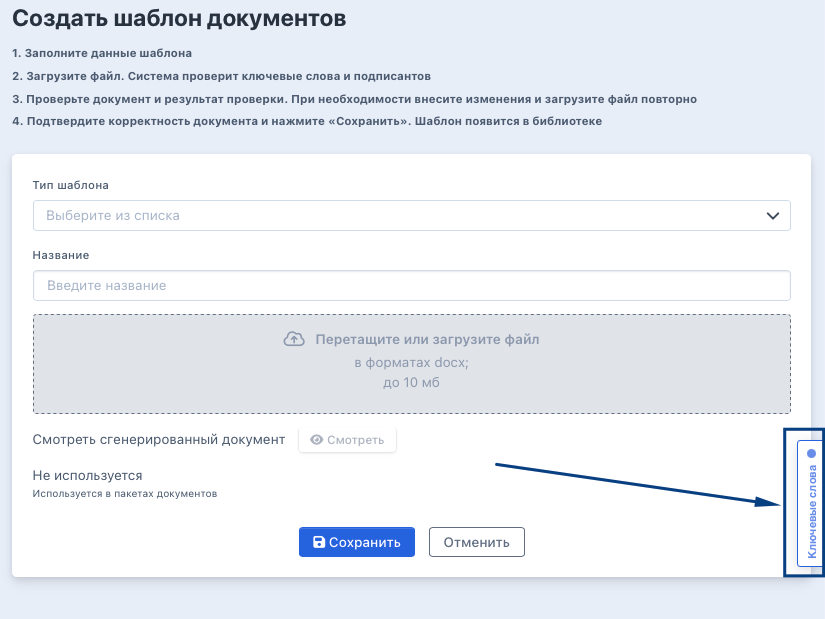
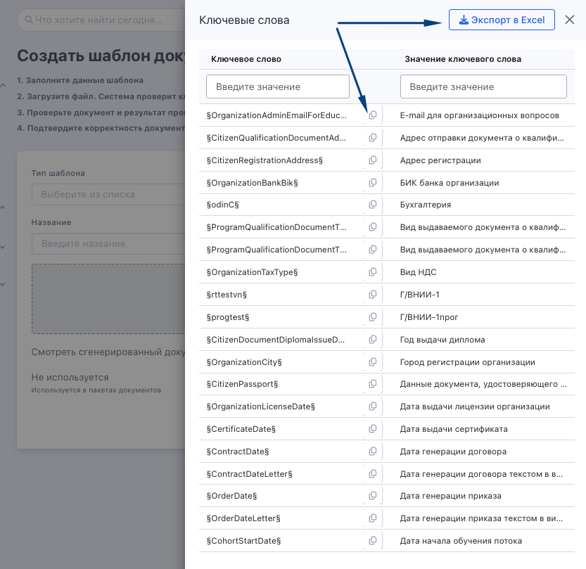

Ключевые слова - набор переменных внутри системы, которые используются для подстановки в генерируемые документы.

Каждому полю, которое заполняется во  Flow,  соответствует своё ключевое слово, заключенное в знаки §. Например,  §CitizenRegistrationAddress§  - Адрес регистрации. \
Когда при генерации документов для заявки слушателя Flow увидит в шаблоне  ключевое слово, то подставит вместо него значение соответствующего поля из [заявки](./../../slushateli/zayavki/sposoby-sozdaniya-zayavok/_index.md) или [организации](./../_index.md). Например, вместо §CitizenBirthDate§  появится дата рождения в формате  дд.мм.гггг.

Для того чтобы корректно подготовить шаблоны для дальнейшей генерации по нему документов для слушателей, необходимо  по тексту вашего файла (файл должен быть в формате .docx)  копировать из Flow и затем вставлять ключевые слова.

.png>)

Чтобы посмотреть весь набор ключевых слов, доступных в системе, со страницы создания шаблона/библиотеки документов кликните «Ключевые слова» справа.

{width=825px height=619px}

Их можно скопировать непосредственно из открывшегося меню, а также скачать в Excel.

{width=833px height=809px}

## Унифицирование ключевых слов в приказах

Ключевые слова унифицированы для использования в таблице, чтобы любые слова можно было использовать в приказах на поток: из таблицы ключевых слов в группе шаблонов, ключевые слова дополнительных полей, ключевые слова внешних источников (это короткое название внешнего источника, заключенное в символы параграфа §).

Пример: организация хочет видеть по каждой заявке в приказе на поток:\
1\. ФИО (стандартное ключевое слово): §CitizenRequestFullName§\
2\. СНИЛС (который собирали через доп данные): §snils§\
3\. Номер заявки с У2035 (данные из внешнего источника): §IdU§
