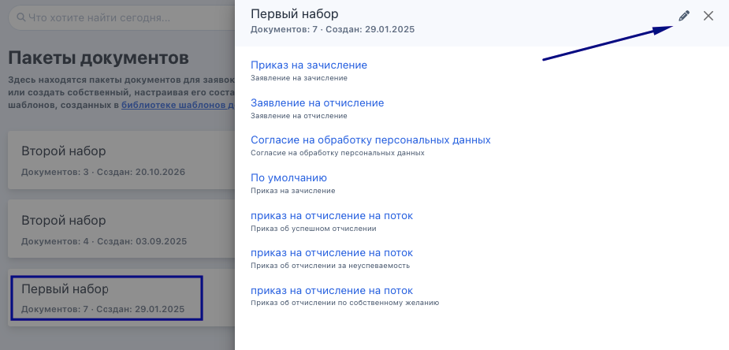
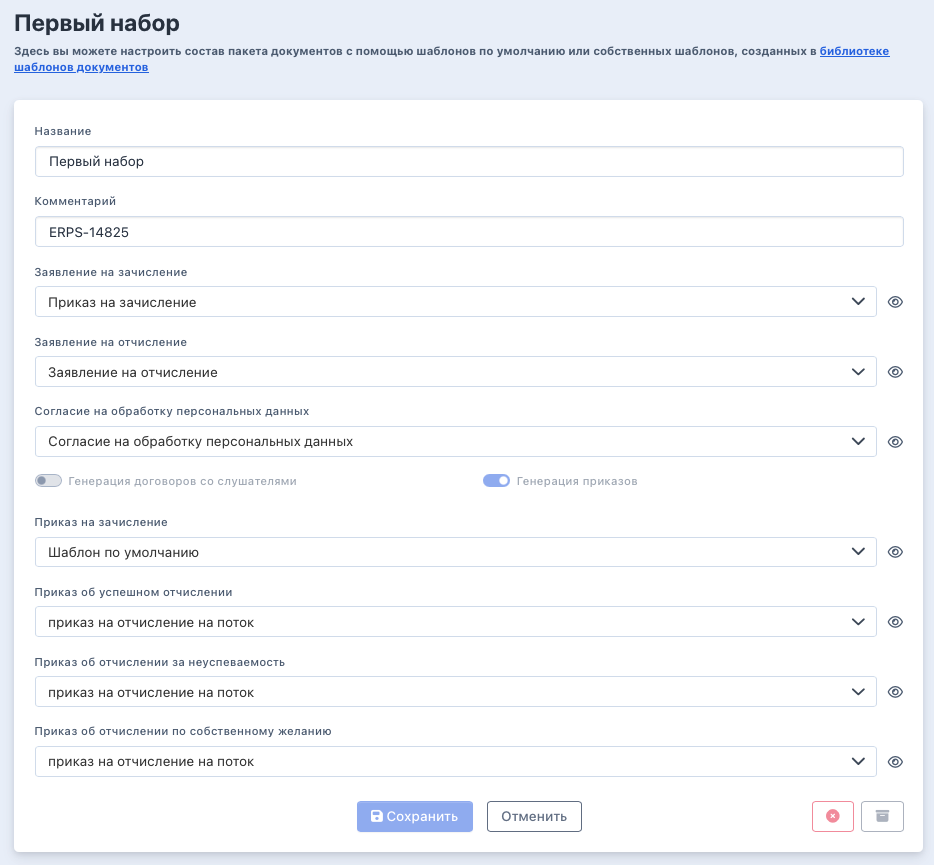

В системе есть страница с пакетами документов, на которой находятся пакеты документов для заявок слушателей. Вы можете использовать пакет по умолчанию или создать собственный, настраивая его состав с помощью шаблонов по умолчанию или собственных шаблонов, созданных в [библиотеке создания документов](./sozdanie-sobstvennykh-shablonov.md).

## Редактирование пакета документов

Чтобы отредактировать уже имеющийся пакет, документов, необходимо кликнуть по нему, а потом нажать на карандашик.

{width=925px height=444px}

Произойдет переход на страницу редактирования шаблона, где можно настроить состав пакета документов с помощью шаблонов по умолчанию или собственных шаблонов, созданных в библиотеке.

{width=934px height=865px}

Редактировать генерацию договоров со слушателями, а также изменить способ выпуска пркиазов нельзя в случае, если по текущему пакету документов уже есть зачисленные на обучение заявки.

После изменения хотя бы одного из шаблонов кнопка «Сохранить» станет активной, по нажатию пакет документов обновится и будет действовать только на документы, сформированные после сохранения, а уже сформированные документы в заявках не поменяются.
