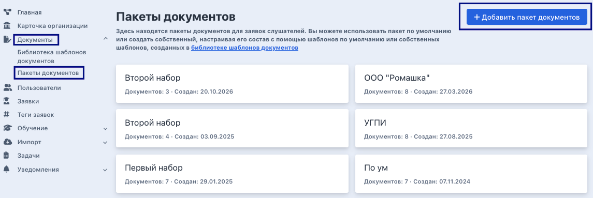
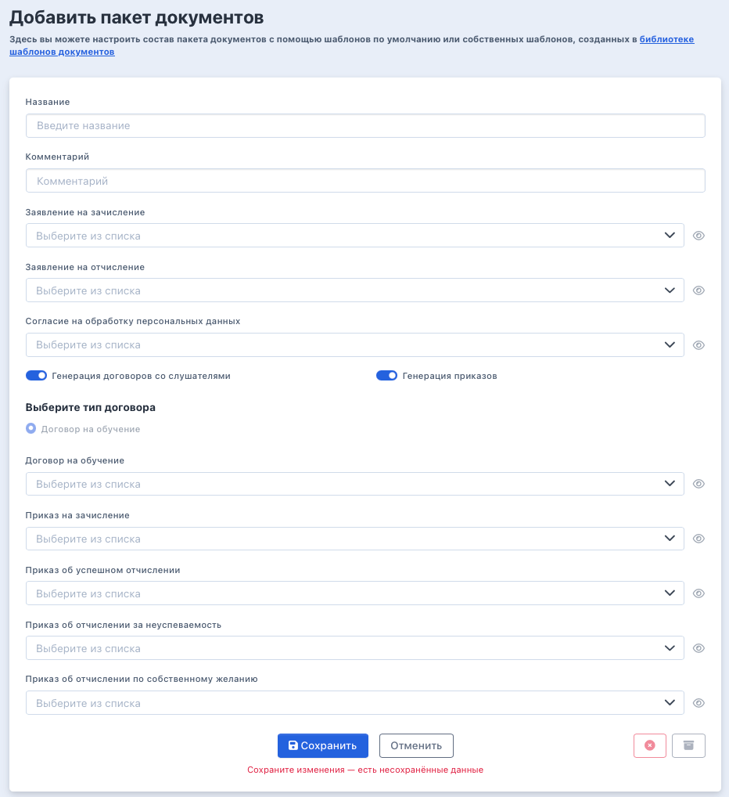

В системе есть страница с пакетами документов, на которой находятся пакеты документов для заявок слушателей. Вы можете использовать пакет по умолчанию или создать собственный, настраивая его состав с помощью шаблонов по умолчанию или собственных шаблонов, созданных в [библиотеке создания документов](./sozdanie-sobstvennykh-shablonov.md).

## Создание пакета докмуентов

Чтобы создать пакет документов, надо нажать на «+Добавить пакет документов».

{width=1145px height=383px}

На странице добавления можно настроить состав пакета документов с помощью шаблонов по умолчанию или собственных шаблонов, созданных в [библиотеке](./sozdanie-sobstvennykh-shablonov.md).

Необходимо ввести название, добавить комментарий, выбрать шаблоны для обязательных документов, включить генерацию договоров со слушателями во Flow (если это предусмотрено), а также отметить автоматический выпуск приказов (опять же, если предусмотрено).

{width=932px height=1018px}

## Редактирование пакета документов

Чтобы отредактировать уже имеющийся пакет документов, необходимо кликнуть по нему, а потом нажать на карандашик.

{width=925px height=444px}

Произойдет переход на страницу редактирования шаблона, где можно настроить состав пакета документов с помощью шаблонов по умолчанию или собственных шаблонов, созданных в библиотеке.

{width=934px height=865px}

Редактировать генерацию договоров со слушателями, а также изменить способ выпуска пркиазов не получится в случае, если по текущему пакету документов уже есть зачисленные на обучение заявки.

После хотя бы одного изменения на странице кнопка «Сохранить» станет активной, по ее нажатию пакет документов обновится и будет действовать только на документы, сформированные после сохранения, а уже сформированные документы в заявках не поменяются.
