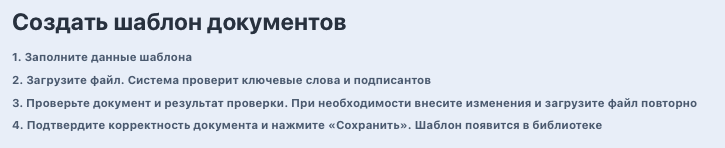
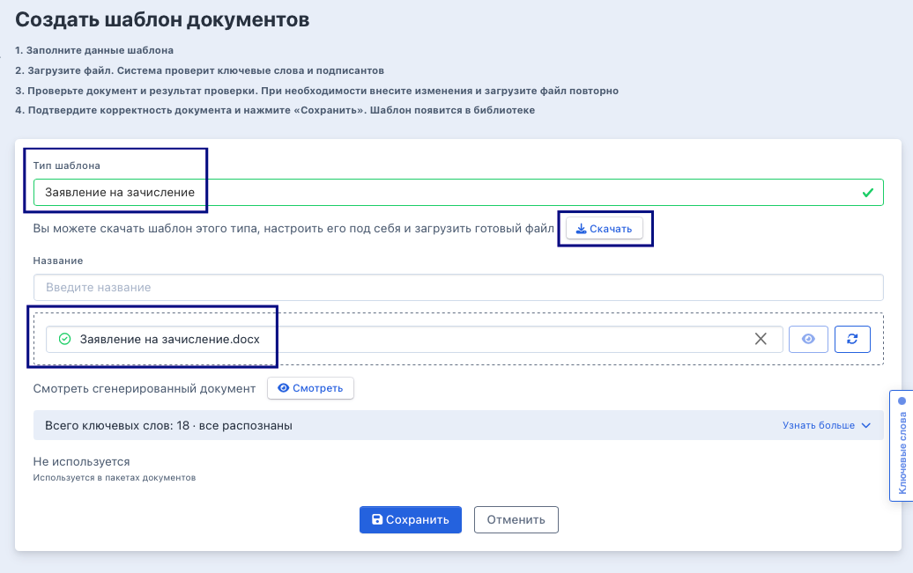
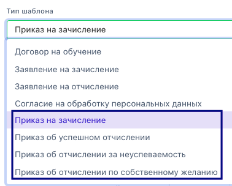
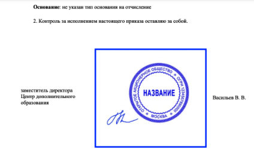

В меню в разделе «Документы» есть подпункт «Библиотека шаблонов документов.

{width=1610px height=351px}

Доступ будет у сотрудника с  правом «Шаблоны и пакеты документов». Если право есть, то пункт доступен, страница открывается, шаблоны можно создавать/редактировать.

На странице библиотеки шаблонов документов можно просматривать шаблоны по умолчанию или добавлять свои собственные. Их можно использовать в разных [пакетах документов](./pakety-dokumentov.md), которые будут генерироваться для заявок слушателей. В созданные шаблоны автоматически подставляются данные [подписанта](./../podpisanty.md) -- сотрудника организации. Добавить, посмотреть или изменить подписантов можно в карточке организации.

Таблица шаблонов содержит столбцы «Тип», «Название шаблона», «Автор шаблона», «Дата создания», «Действие», таблицу можно экспортировать в Excel, настроить свои личные фильтры, сбросить все настройки.

**Шаблоны по умолчанию** есть у семи типов: заявление на зачисление, заявление на отчисление, согласие на обработку персональных данных и четыре приказа. У договора на обучение шаблона по умолчанию нет, его необходимо будет подготовить самостоятельно, подставив по тексту [ключевые слова](./klyuchevye-slova.md).

По любому шаблону в таблице можно кликнуть на название и попасть на его страницу для редактирования.

## **Создание шаблона**

По клику на кнопку «+ Добавить шаблон» -- открывается страница «Создать шаблон документов».

{width=1610px height=356px}

На странице есть инструкция по созданию:

1\. Заполните данные шаблона.

2\. Загрузите файл. Система проверит ключевые слова и подписантов.

3\. Проверьте документ и результат проверки. При необходимости внесите изменения и загрузите файл повторно.

4\. Подтвердите корректность документа и нажмите «Сохранить». Шаблон появится в библиотеке.

{width=725px height=148px}

После выбора типа шаблона  дропзона становится активной. Если у выбранного типа есть шаблон по умолчанию, то можно «Скачать» файл этого шаблона. Загрузить в систему можно файл только с расширением .docx не более 10 МБ. После загрузки файл можно просмотреть, заменить, удалить.

Проверка ключевых слов и подписанта запускается автоматически сразу после загрузки файла при создании шаблона, при загрузке нового файла в карточке шаблона и при замене файла иконкой со стрелками. Под дропзоной сразу появляется сводка проверки.

{width=1036px height=651px}

Если в документе предусмотрена подпись сотрудника вашей организации, сначала добавьте [подписанта](./../podpisanty.md) в карточке организации. Его ФИО, должность и основание полномочий будут подставляться в документ с помощью ключевых слов.

После сохранения шаблон можно использовать при создании пакетов документов.

Шаблон можно отредактировать, но все изменения шаблона будут действовать только на документы, сформированные после сохранения. Уже сформированные документы в заявках не поменяются.

## Выпуск приказов

При выборе автоматического выпуска приказов будут предложены 4 шаблона: один для приказа на зачисление и три на отчисление (в зависимости от основания отчисления).

{width=378px height=304px}

:::danger

В шаблоне каждого из приказов вы увидите картинку с крестиком, она обязательно должна присутствовать и в вашем шаблоне, поэтому либо отредактируйте стандартный шаблон в соответствии с требованиями вашей организации (предпочтительнее, чтобы не сбить местоположение и размер крестика), либо скопируйте картинку и вставьте её в свой шаблон.

.png>)

:::

Когда приказ будет генерироваться для заявки, вместо крестика появится [штамп подписанта](./../podpisanty.md).

{width=424px height=281px}
