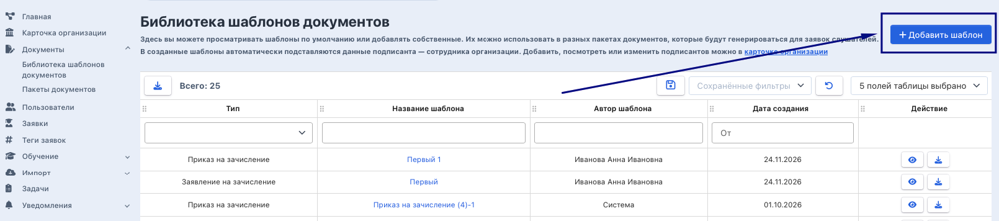

В меню в разделе «Документы» есть подпункт «Библиотека шаблонов документов.

{width=1610px height=351px}

Доступ будет у сотрудника с  правом «Шаблоны и пакеты документов». Если право есть, то пункт доступен, страница открывается, шаблоны можно создавать/редактировать.

На странице библиотеки шаблонов документов можно просматривать шаблоны по умолчанию или добавлять свои собственные. Их можно использовать в разных пакетах документов, которые будут генерироваться для заявок слушателей. В созданные шаблоны автоматически подставляются данные [подписанта](./../podpisanty.md) -- сотрудника организации. Добавить, посмотреть или изменить подписантов можно в карточке организации.

Таблица шаблонов содержит столбцы «Тип», «Название шаблона», «Автор шаблона», «Дата создания», «Действие», таблицу можно экспортировать в Excel, настроить свои личные фильтры, сбросить все настройки.

**Шаблоны по умолчанию** есть у семи типов: заявление на зачисление, заявление на отчисление, согласие на обработку персональных данных и четыре приказа. У договора на обучение шаблона по умолчанию нет.

По любому шаблону можно кликнуть на название и попасть на его страницу для редактирования.

## **Создание шаблона**

По клику на кнопку «+ Добавить шаблон» -- открывается страница «Создать шаблон документов».

{width=1610px height=356px}

На странице есть инструкция по созданию:

1\. Заполните данные шаблона.

2\. Загрузите файл. Система проверит ключевые слова и подписантов.

3\. Проверьте документ и результат проверки. При необходимости внесите изменения и загрузите файл повторно.

4\. Подтвердите корректность документа и нажмите «Сохранить». Шаблон появится в библиотеке.

{width=725px height=148px}

После выбора типа шаблона  дропзона становится активной. Если у выбранного типа есть шаблон по умолчанию, то можно «Скачать» файл этого шаблона. Загрузить в систему можно файл только с расширением .docx не более 10 МБ. После загрузки файл можно просмотреть, заменить, удалить.

Проверка ключевых слов и подписанта запускается автоматически сразу после загрузки файла -- при создании шаблона, при загрузке нового файла в карточке шаблона и при замене файла иконкой со стрелками. Под дропзоной сразу появляется сводка проверки.

{width=1036px height=651px}

Если в документе предусмотрена подпись сотрудника вашей организации, сначала добавьте подписанта в карточке организации. Его ФИО, должность и основание полномочий будут подставляться в документ с помощью ключевых слов».

После сохранения шаблон можно использовать при создании пакетов документов. Шаблон можно отредактировать, но все изменения шаблона будут действовать только на документы, сформированные после сохранения. Уже сформированные документы в заявках не поменяются.

## Шаг 1. Шаблоны документов

Перейдите в шаблоны документов.

.png>)

По умолчанию будет сгенерирована первая группа шаблонов, где:

- есть три образца документов:
  - Заявление на зачисление
  - Заявление на отчисление
  - Согласие на обработку персональных данных
- доступно включение:
  - [автоматического выпуска приказов](./../../obuchenie/prikaz/avtomaticheskii-vypusk.md)
  - генерации договоров со слушателями

.png>)

1. Измените название группы шаблонов на понятное для вас, например "Педагоги_ПО"/"Все ДПО".
2. Внесите комментарий, если это необходимо.
3. Определите, какие документы будут автоматически генерироваться во Flow в данной группе шаблонов, и приступайте к шагу 2.

Так как в организации может быть несколько групп шаблонов, а подписанты для документов добавляются не в группу шаблонов, а в организацию, то добавлен блок "Подписанты", чтобы была возможность посмотреть, кто будет подписантом у документов в группе.

По кнопке "Перейти в карточку организации" пользователь попадает на страницу Подписанты.

.png>)

## Шаг 2. Скачивание и редактирование обязательных шаблонов документов

1\.Скачайте шаблон документа Заявление

.png>)

2\.Откройте файл с заявлением и ключевые слова (можно открыть во Flow или скачать файл Excel и открыть его). На примере заявления на зачисление посмотрите, как по тексту подставляются ключевые слова.

Например, ключевое слово **§ProgramType§** - тип программы, найдя его в шаблоне, Flow подставит значение из поля тип программы из заявки слушателя, когда для него будет генерироваться заявление на зачисление.

.png>)

3\.Если в заявлении на зачисление требуются корректировки, внесите их, копируя ключевые слова.

:::danger

Важно: при создании своего шаблона/редактировании текущего [**ключевые слова**](./klyuchevye-slova.md) со спецсимволами надо именно **копировать**.

:::

4\.Сохраните файл со своими дополнениями

5\.Загрузите скорректированный файл во Flow

.png>)

Повторите пункты 1-5 с заявлением на отчисление и с согласием на обработку персональных данных.

:::info

Если в вашей образовательной организации актуальны другие бланки для заявлений и согласия, то загрузите их, предварительно подставив в шаблон [ключевые слова](./klyuchevye-slova.md) из Flow.

:::

6\.Проверьте каждый из загруженных документов, нажав на "глаз"

.png>)

## Шаг 3. Выпуск приказов

:::info

Пропустите шаг 3, если [приказы](./../../obuchenie/prikaz/_index.md) не будут автоматически генерироваться во Flow.

:::

При выборе автоматического выпуска приказов будет предложено 2 шаблона для приказа на зачисление и отчисление (причина отчисления будет подтягиваться в приказ из статуса заявки).

.png>)

Повторите пункты 1-5 из шага 2.

:::danger

В шаблоне каждого из приказов вы увидите картинку с крестиком, она обязательно должна присутствовать и в вашем шаблоне, поэтому либо отредактируйте данный шаблон в соответствии с требованиями вашей организации (предпочтительнее, чтобы не сбить местоположение и размер крестика), либо скопируйте картинку и вставьте её в свой шаблон.

.png>)

:::

Когда приказ будет генерироваться для заявки, вместо крестика появится [штамп подписанта](./../podpisanty.md).

.png>)

## Шаг 4. Генерация договоров со слушателями

:::info

Пропустите шаг 4, если договоры не будут автоматически генерироваться во Flow.

:::

У каждой организации свои требования к договору на обучение, поэтому, нажав "Разрешить", не будет образца документа.

.png>)

Шаблон договора необходимо будет подготовить самостоятельно, подставив по тексту [ключевые слова](./klyuchevye-slova.md). Попрактиковавшись на шаге 2 и 3, переходите к его созданию:

1. Создайте файл в формате .docx
2. Вставьте в него текст договора на обучение вашей организации
3. По тексту подставьте [ключевые слова](./klyuchevye-slova.md) (обязательно через копировать-вставить)
4. Сохраните файл
5. Загрузите его во Flow

.png>)

## Шаг 5. Сохранение группы шаблонов

Сохраните группу шаблонов.

После сохранения, если в организации будет использоваться несколько групп шаблонов, перейдите к созданию следующей группы.

Выбрать подходящую группу шаблонов будет возможно на странице [заявки](./../../slushateli/zayavki/sposoby-sozdaniya-zayavok/_index.md).

.png>)

---

Поздравляем! 🎉 Процесс заполнения группы шаблонов завершен!
