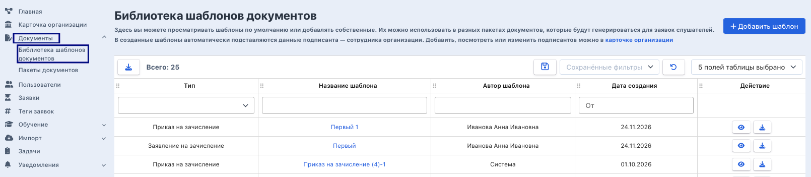

В меню в разделе «Документы» есть подпункт «Библиотека шаблонов документов.

{width=1610px height=351px}

Доступ будет у сотрудника с  правом «Шаблоны и пакеты документов». Если право есть, то пункт доступен, страница открывается, шаблоны можно создавать/редактировать.

На странице библиотеки шаблонов документов можно просматривать шаблоны по умолчанию или добавлять свои собственные. Их можно использовать в разных пакетах документов, которые будут генерироваться для заявок слушателей. В созданные шаблоны автоматически подставляются данные [подписанта](./../podpisanty.md) -- сотрудника организации. Добавить, посмотреть или изменить подписантов можно в карточке организации.

Таблица шаблонов содержит столбцы «Тип», «Название шаблона», «Автор шаблона», «Дата создания», «Действие», таблицу можно экспортировать в Excel, настроить свои личные фильтры, сбросить все настройки.

**Шаблоны по умолчанию** есть у семи типов: заявление на зачисление, заявление на отчисление, согласие на обработку персональных данных и четыре приказа. У договора на обучение шаблона по умолчанию нет.

По любому шаблону можно кликнуть на название и попасть на его страницу для редактирования.

**Ключевые слова**

6\. Пользователь нажимает вкладку «Ключевые слова» -- справа открывается боковая панель «Ключевые слова». [Макет](https://www.figma.com/design/aZqtIGVaAkr6GVztdEnlAI/Flow?node-id=89513-144692)

- Столбцы: «Ключевое слово», кнопка копирования, «Значение ключевого слова». Над столбцами -- поля поиска «Введите значение».
- Ключевые слова в формате §…§.
- Если пользователь нажимает кнопку копирования -- ключевое слово вместе с символами § копируется в буфер обмена.
- «Экспорт в Excel» выгружает список ключевых слов в Excel, как сейчас на странице групп шаблонов.
- Список с пагинацией.
- Список ключевых слов -- тот же, что сейчас в блоке «Ключевые слова» на странице групп шаблонов; если у организации есть интеграция с РР -- показываем и ключевые слова РР.
- Крестик закрывает панель.
- Панель доступна и на странице библиотеки, и на странице шаблона.
- Столбец «Относится к» с фильтром по сущностям в этой задаче не делаем.

\[Скрин 3\] Панель «Ключевые слова» -- [Макет](https://www.figma.com/design/aZqtIGVaAkr6GVztdEnlAI/Flow?node-id=89563-27713)

**Создание шаблона**

7\. Пользователь нажимает «+ Добавить шаблон» -- открывается страница «Создать шаблон документов». [Макет](https://www.figma.com/design/aZqtIGVaAkr6GVztdEnlAI/Flow?node-id=89900-64631)

- Инструкция: «1. Заполните данные шаблона. 2. Загрузите файл. Система проверит ключевые слова и подписантов. 3. Проверьте документ и результат проверки. При необходимости внесите изменения и загрузите файл повторно. 4. Подтвердите корректность документа и нажмите «Сохранить». Шаблон появится в библиотеке».
- «Тип шаблона» -- выпадающий список, плейсхолдер «Выберите из списка». Обязательное.
- Текст «Вы можете скачать шаблон этого типа, настроить его под себя и загрузить готовый файл» и кнопка «Скачать». Неактивна, пока не выбран тип.
- «Название» -- плейсхолдер «Введите название». Обязательное.
- Дропзона «Перетащите или загрузите файл, в формате .docx, до 10 мб». Неактивна, пока не выбран тип. Обязательная.
- «Используется в пакетах документов» -- только чтение, у нового шаблона «Не используется».
- Кнопки «Сохранить» (активна всегда) и «Отменить».
- Кнопка удаления на макете есть, но в эту задачу не входит.

\[Скрин 4\] Создание шаблона: пустая форма -- [Макет](https://www.figma.com/design/aZqtIGVaAkr6GVztdEnlAI/Flow?node-id=89510-136376)

8\. Список «Тип шаблона»: Договор на обучение, Заявление на зачисление, Заявление на отчисление, Согласие на обработку персональных данных, Приказ на зачисление, Приказ об успешном отчислении, Приказ об отчислении за неуспеваемость, Приказ об отчислении по собственному желанию. [Макет](https://www.figma.com/design/aZqtIGVaAkr6GVztdEnlAI/Flow?node-id=89513-137641)

- «Договор оферты» на макете есть, в список не добавляем. **ОФЕРТУ В ЭТОЙ ЗАДАЧЕ НЕ ДЕЛАЕМ!**

\[Скрин 5\] Список типов шаблона -- [Макет](https://www.figma.com/design/aZqtIGVaAkr6GVztdEnlAI/Flow?node-id=89513-137641)

9\. Пользователь выбирает тип -- дропзона становится активной. [Макет](https://www.figma.com/design/aZqtIGVaAkr6GVztdEnlAI/Flow?node-id=89513-137427)

- Если у типа есть шаблон по умолчанию -- «Скачать» активна и скачивает .docx шаблона по умолчанию этого типа.
- Если выбран «Договор на обучение» -- «Скачать» неактивна: шаблона договора по умолчанию нет. [Макет](https://www.figma.com/design/aZqtIGVaAkr6GVztdEnlAI/Flow?node-id=89558-22225)
- Если пользователь меняет тип после загрузки файла -- файл и сводка по ключевым словам сбрасываются, файл нужно загрузить заново.

10\. Пользователь загружает файл. [Макет](https://www.figma.com/design/aZqtIGVaAkr6GVztdEnlAI/Flow?node-id=89790-23037)

- Если файл не .docx -- файл не загружается, ошибка «Поддерживаются файлы формата .docx» с заголовком «Ошибка загрузки файла».
- Если файл больше 10 МБ -- файл не загружается, показываем ошибку о превышении размера.
- После загрузки в дропзоне строка с именем файла и зелёной галочкой и три иконки:
  - крестик -- убрать файл, дропзона снова пустая, сводка пропадает;
  - стрелки -- выбрать другой файл вместо загруженного, сводка пересчитывается.
- Проверка ключевых слов и подписанта запускается автоматически сразу после загрузки файла -- при создании шаблона, при загрузке нового файла в карточке шаблона и при замене файла иконкой со стрелками. Под дропзоной сразу появляется свёрнутая сводка (шаг 11)».
- Добавляем под дроп-зону строчку «Смотреть сгенерированный документ» с кнопкой «Смотреть»:
- кнопка неактивна до момента загрузки документа - [макет](https://www.figma.com/design/aZqtIGVaAkr6GVztdEnlAI/Flow?node-id=90611-15966&t=mOhU4AoFwXEqe1M3-4), [макет](https://www.figma.com/design/aZqtIGVaAkr6GVztdEnlAI/Flow?node-id=90611-15980&t=mOhU4AoFwXEqe1M3-4)
- кнопка становится активной, когда файл загрузили в дроп-зону - [макет](https://www.figma.com/design/aZqtIGVaAkr6GVztdEnlAI/Flow?node-id=90611-15994&t=mOhU4AoFwXEqe1M3-4)
- Меняем цвет фона со сводкой по ключевым словам:
- обводка становится цветом основного фона Flow #EDF2F9
- если ключевые слова распознаны, то текст заголовка сводки (Всего ключевых слов - Все распознаны) меняем на основной цвет текста Flow - [скрытая](https://www.figma.com/design/aZqtIGVaAkr6GVztdEnlAI/Flow?node-id=89513-138080&t=mOhU4AoFwXEqe1M3-4), [раскрытая](https://www.figma.com/design/aZqtIGVaAkr6GVztdEnlAI/Flow?node-id=89513-138810&t=mOhU4AoFwXEqe1M3-4)
- у сводки с нераспознанными ключевыми словами меняем только фон - [скрытая](https://www.figma.com/design/aZqtIGVaAkr6GVztdEnlAI/Flow?node-id=89513-138327&t=mOhU4AoFwXEqe1M3-4), [раскрытая](https://www.figma.com/design/aZqtIGVaAkr6GVztdEnlAI/Flow?node-id=89558-20714&t=mOhU4AoFwXEqe1M3-4)
- Если зашли в редактирование, то кнопка остается активной - [макет](https://www.figma.com/design/aZqtIGVaAkr6GVztdEnlAI/Flow?node-id=90611-16025&t=mOhU4AoFwXEqe1M3-4)

\[Скрин 6\] Файл загружен, свёрнутая сводка -- [Макет](https://www.figma.com/design/aZqtIGVaAkr6GVztdEnlAI/Flow?node-id=89513-137831)

11\. Сводка по ключевым словам.

- Система находит в файле все ключевые слова вида §…§ и проверяет, знает ли их система: системные ключевые слова, ключевые слова дополнительных полей организации и её интеграций -- так же, как админский инструмент «Проверка тегов шаблона».
- Свёрнутая сводка:
  - если все распознаны -- «Всего ключевых слов: N · все распознаны» ([Макет](https://www.figma.com/design/aZqtIGVaAkr6GVztdEnlAI/Flow?node-id=89513-137831));
  - если есть нераспознанные -- «Всего ключевых слов: N · не распознаны: K», красным ([Макет](https://www.figma.com/design/aZqtIGVaAkr6GVztdEnlAI/Flow?node-id=89513-138091)).
- «Узнать больше» разворачивает список всех ключевых слов из файла ([Макет](https://www.figma.com/design/aZqtIGVaAkr6GVztdEnlAI/Flow?node-id=89513-138810)):
  - распознанное -- зелёная плашка и значение ключевого слова;
  - нераспознанное -- красная плашка и текст «Неизвестное ключевое слово · Отсутствует в справочнике системы» ([Макет](https://www.figma.com/design/aZqtIGVaAkr6GVztdEnlAI/Flow?node-id=89513-138337)).
- Повторное нажатие сворачивает список.
- Нераспознанные ключевые слова сохранение не блокируют.

12\. Проверка подписанта.

- Если у организации нет подписанта -- под сводкой красное уведомление: «Нет подписанта. Если в документе предусмотрена подпись сотрудника вашей организации, сначала добавьте подписанта в карточке организации. Его ФИО, должность и основание полномочий будут подставляться в документ с помощью ключевых слов». «карточке организации» -- ссылка.
- Показываем независимо от того, распознаны ключевые слова или нет.
- Если подписант есть -- уведомление не показываем.
- Отсутствие подписанта сохранение не блокирует.

\[Скрин 7\] Развёрнутая сводка и уведомление о подписанте -- [Макет](https://www.figma.com/design/aZqtIGVaAkr6GVztdEnlAI/Flow?node-id=89513-138337)

**Сохранение и отмена**

13\. Пользователь нажимает «Сохранить». [Макет](https://www.figma.com/design/aZqtIGVaAkr6GVztdEnlAI/Flow?node-id=89558-21933)

- Обязательные поля: «Тип шаблона», «Название», файл.
- Если название пустое или из одних пробелов -- поле считается незаполненным.
- Если хотя бы одно обязательное поле не заполнено -- шаблон не сохраняем, данные не сбрасываем:
  - у пустого типа и названия -- красная рамка и «Поле должно быть заполнено», у названия ещё иконка «!»;
  - у файла -- «Загрузите файл».
- Если тип выбран, а название и файл нет -- ошибки у названия и файла. [Макет](https://www.figma.com/design/aZqtIGVaAkr6GVztdEnlAI/Flow?node-id=89558-22225)
- Если пользователь заполнил поле с ошибкой -- ошибка у этого поля пропадает.

\[Скрин 8\] Договор: «Скачать» неактивна, ошибки при сохранении -- [Макет](https://www.figma.com/design/aZqtIGVaAkr6GVztdEnlAI/Flow?node-id=89558-22225)

14\. Если все обязательные поля заполнены -- шаблон сохраняется. [Макет](https://www.figma.com/design/aZqtIGVaAkr6GVztdEnlAI/Flow?node-id=89513-141495)

- Пользователь возвращается в библиотеку, справа вверху уведомление «Изменения сохранены».
- Новый шаблон -- первым в таблице, автор -- текущий пользователь, дата -- дата сохранения.
- Новый шаблон сразу доступен в выпадающих списках своего типа на странице пакета документов.
- Если при сохранении произошла ошибка -- остаёмся на странице с данными, показываем уведомление об ошибке.

15\. Пользователь нажимает «Отменить» - на странице создания и в карточке шаблона: изменения не сохраняются, пользователь возвращается в библиотеку. На странице создания шаблон не создаётся.

**Карточка шаблона**

16\. Шаблон не используется ни в одном пакете -- пользователь кликает по названию. [Макет](https://www.figma.com/design/aZqtIGVaAkr6GVztdEnlAI/Flow?node-id=89513-140833)

- Заголовок -- название шаблона, под ним та же инструкция.
- Все поля доступны: тип, название, файл.
- Дропзона пустая, под ней ссылка «Ранее загруженный файл» -- скачивает текущий файл шаблона.
- Сводка по ключевым словам текущего файла показана сразу.
- «Используется в пакетах документов» -- «Не используется».
- Если пользователь не загрузил новый файл -- при сохранении остаётся текущий.
- Если загрузил новый -- он заменяет текущий, сводка пересчитывается.
- Если пользователь сменил тип -- текущий файл сбрасывается: дропзона пустая, ссылка «Ранее загруженный файл» и сводка пропадают»;
- «Если после смены типа нажать «Сохранить» без нового файла -- шаблон не сохраняется, под дропзоной ошибка «Загрузите файл»»;
- «Если пользователь вернул прежний тип -- файл сам не возвращается. Чтобы отменить изменения, нажимают «Отменить» - карточка закрывается без сохранения».
- «При открытии карточки показываем сводку по ключевым словам и проверку подписанта для текущего файла».
- Проверки и результат сохранения -- как в шагах 13–14.

\[Скрин 10\] Карточка неиспользуемого шаблона -- [Макет](https://www.figma.com/design/aZqtIGVaAkr6GVztdEnlAI/Flow?node-id=89513-140833)

17\. Шаблон используется хотя бы в одном пакете -- пользователь кликает по названию. [Макет](https://www.figma.com/design/aZqtIGVaAkr6GVztdEnlAI/Flow?node-id=89563-24580)

- Тип и дропзона заблокированы: заменить файл и сменить тип нельзя.
- Редактировать можно только название.
- «Ранее загруженный файл» скачивает текущий файл, «Скачать» -- шаблон по умолчанию этого типа.
- Сводка по ключевым словам текущего файла показана.
- «Используется в пакетах документов» -- названия пакетов через запятую.
- Если пользователь переименовал шаблон -- новое название сразу видно в пакетах, где он выбран.
- «Файл используемого шаблона заменить нельзя: шаблон может стоять в нескольких пакетах, и замена файла изменила бы документы во всех них»;
- «Если нужно изменить файл -- пользователь скачивает текущий файл по ссылке «Ранее загруженный файл», исправляет его, загружает в библиотеку как новый шаблон и выбирает новый шаблон в нужных пакетах. Удалять пакет не нужно»;
- «Когда шаблон перестаёт использоваться во всех пакетах, его карточка становится полностью редактируемой (шаг 16)».

\[Скрин 11\] Карточка используемого шаблона -- [Макет](https://www.figma.com/design/aZqtIGVaAkr6GVztdEnlAI/Flow?node-id=89563-24580)

**Правила, которые сохраняем**

- Изменения шаблона действуют только на документы, сформированные после сохранения. Уже сформированные документы в заявках не меняются.
- Шаблон доступен только своей организации: в библиотеке, в пакетах и в генерации документов используются только шаблоны организации заявки.
- Формат и размер файла -- только .docx, до 10 МБ.

**Миграция существующих шаблонов**

- Все шаблоны, которые организации загрузили в группы шаблонов, переносим в библиотеку как шаблоны организации.
- Каждый файл из каждой группы становится отдельным шаблоном библиотеки. Одинаковые файлы из разных групп не склеиваем.
- Название -- имя загруженного файла без расширения.
- Автор -- «Система».
- Дата создания -- дата создания группы, в которой лежал файл.
- Тип -- тип документа, под который файл был загружен в группе.
- Перенесённый шаблон остаётся выбранным в своём пакете документов (бывшей группе): документы по пакету генерируются так же, как до миграции.
- Если в группе для типа документа использовался системный шаблон -- в пакете остаётся «Шаблон по умолчанию».

## Шаг 1. Шаблоны документов

Перейдите в шаблоны документов.

.png>)

По умолчанию будет сгенерирована первая группа шаблонов, где:

- есть три образца документов:
  - Заявление на зачисление
  - Заявление на отчисление
  - Согласие на обработку персональных данных
- доступно включение:
  - [автоматического выпуска приказов](./../../obuchenie/prikaz/avtomaticheskii-vypusk.md)
  - генерации договоров со слушателями

.png>)

1. Измените название группы шаблонов на понятное для вас, например "Педагоги_ПО"/"Все ДПО".
2. Внесите комментарий, если это необходимо.
3. Определите, какие документы будут автоматически генерироваться во Flow в данной группе шаблонов, и приступайте к шагу 2.

Так как в организации может быть несколько групп шаблонов, а подписанты для документов добавляются не в группу шаблонов, а в организацию, то добавлен блок "Подписанты", чтобы была возможность посмотреть, кто будет подписантом у документов в группе.

По кнопке "Перейти в карточку организации" пользователь попадает на страницу Подписанты.

.png>)

## Шаг 2. Скачивание и редактирование обязательных шаблонов документов

1\.Скачайте шаблон документа Заявление

.png>)

2\.Откройте файл с заявлением и ключевые слова (можно открыть во Flow или скачать файл Excel и открыть его). На примере заявления на зачисление посмотрите, как по тексту подставляются ключевые слова.

Например, ключевое слово **§ProgramType§** - тип программы, найдя его в шаблоне, Flow подставит значение из поля тип программы из заявки слушателя, когда для него будет генерироваться заявление на зачисление.

.png>)

3\.Если в заявлении на зачисление требуются корректировки, внесите их, копируя ключевые слова.

:::danger

Важно: при создании своего шаблона/редактировании текущего [**ключевые слова**](./klyuchevye-slova.md) со спецсимволами надо именно **копировать**.

:::

4\.Сохраните файл со своими дополнениями

5\.Загрузите скорректированный файл во Flow

.png>)

Повторите пункты 1-5 с заявлением на отчисление и с согласием на обработку персональных данных.

:::info

Если в вашей образовательной организации актуальны другие бланки для заявлений и согласия, то загрузите их, предварительно подставив в шаблон [ключевые слова](./klyuchevye-slova.md) из Flow.

:::

6\.Проверьте каждый из загруженных документов, нажав на "глаз"

.png>)

## Шаг 3. Выпуск приказов

:::info

Пропустите шаг 3, если [приказы](./../../obuchenie/prikaz/_index.md) не будут автоматически генерироваться во Flow.

:::

При выборе автоматического выпуска приказов будет предложено 2 шаблона для приказа на зачисление и отчисление (причина отчисления будет подтягиваться в приказ из статуса заявки).

.png>)

Повторите пункты 1-5 из шага 2.

:::danger

В шаблоне каждого из приказов вы увидите картинку с крестиком, она обязательно должна присутствовать и в вашем шаблоне, поэтому либо отредактируйте данный шаблон в соответствии с требованиями вашей организации (предпочтительнее, чтобы не сбить местоположение и размер крестика), либо скопируйте картинку и вставьте её в свой шаблон.

.png>)

:::

Когда приказ будет генерироваться для заявки, вместо крестика появится [штамп подписанта](./../podpisanty.md).

.png>)

## Шаг 4. Генерация договоров со слушателями

:::info

Пропустите шаг 4, если договоры не будут автоматически генерироваться во Flow.

:::

У каждой организации свои требования к договору на обучение, поэтому, нажав "Разрешить", не будет образца документа.

.png>)

Шаблон договора необходимо будет подготовить самостоятельно, подставив по тексту [ключевые слова](./klyuchevye-slova.md). Попрактиковавшись на шаге 2 и 3, переходите к его созданию:

1. Создайте файл в формате .docx
2. Вставьте в него текст договора на обучение вашей организации
3. По тексту подставьте [ключевые слова](./klyuchevye-slova.md) (обязательно через копировать-вставить)
4. Сохраните файл
5. Загрузите его во Flow

.png>)

## Шаг 5. Сохранение группы шаблонов

Сохраните группу шаблонов.

После сохранения, если в организации будет использоваться несколько групп шаблонов, перейдите к созданию следующей группы.

Выбрать подходящую группу шаблонов будет возможно на странице [заявки](./../../slushateli/zayavki/sposoby-sozdaniya-zayavok/_index.md).

.png>)

---

Поздравляем! 🎉 Процесс заполнения группы шаблонов завершен!
