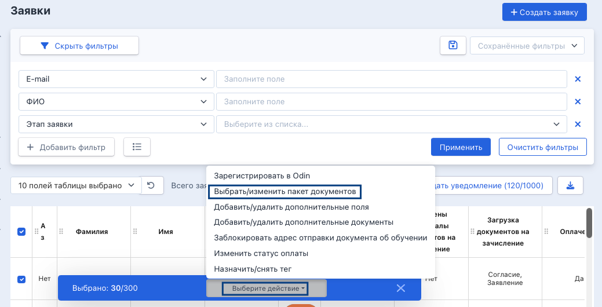
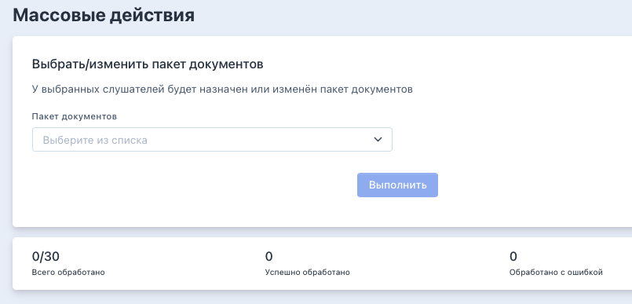

Шаг 1. Создайте пакет документов (можно использовать и ранее созданный)

:::note

Важно помнить. Если пакет докмуентов установлен в программе, то всех заявках программы, созданных после указания в ней этого пакета, документы будут генерироваться на основании установленного пакета. Повторное указание не требуется.

:::

Шаг 2. В настраиваемом списке заявок выберите необходимые заявки  -> появляется плашка с доступными действиями -> выберите выбор/изменение пакета докмуентов.

{width=1039px height=530px}

Шаг 3. Выберите пакет документов и нажмите «Выполнить»

{width=805px height=387px}

Шаг 4. Дождитесь завершения действия. При необходимости исправьте ошибки.
